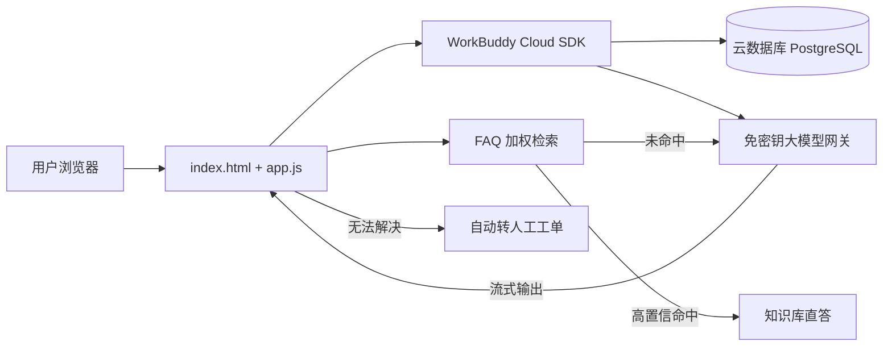

# 智能客服 Agent

一个带云端持久化与大模型能力的全栈客服 Web 应用：多轮对话、FAQ 知识库检索、意图识别、无法解决时自动转人工、满意度评价，以及可查看对话记录与统计的管理后台。

## 在线演示

**https://smart-support-agent-26228.app.workbuddy.host/?sharecode=WRNQK76XET**

> 访问时请保留 `?sharecode=...` 参数，直接打开根域名会被平台判定为链接不完整。该链接可直接转发给任何人，无需登录。

## 功能

- **多轮对话**：会话列表、新建 / 切换会话，消息写入云端数据库，刷新页面不丢失。
- **FAQ 知识库检索**：本地加权打分（问题 + 关键词 + 分类），高置信度命中时直接返回标准答案，避免大模型幻觉。
- **意图识别**：退款 / 查询订单 / 技术支持 / 通用四类，大模型 JSON 输出 + 置信度，模型失败时自动降级为本地关键词分类。
- **RAG 流式回复**：知识库未命中时，注入 Top 3 FAQ 作为上下文，携带会话 ID 与最近 10 条历史调用大模型流式生成。
- **自动转人工**：用户主动要求、模型输出 `[NEED_HUMAN]`、或满意度 ≤ 2 星时，自动创建工单并更新会话状态。
- **满意度评价**：1–5 星 + 文字评价，写入云端。
- **本轮分析面板**：实时展示意图、置信度、命中条目与 5 步处理链路。
- **管理后台**：会话数 / 消息数 / 平均满意度 / 转人工率 / 知识库条目 5 个 KPI，满意度分布、意图分布、近 7 日趋势图，工单状态管理，对话记录全文展开，支持全部 / 近 7 天 / 近 30 天筛选。

## 技术架构



- **前端**：原生 HTML / CSS / JavaScript，无构建步骤、无框架依赖。
- **云服务**：`@tencent-ai/workbuddy-cloud-sdk`（CDN 引入），提供数据库读写与大模型调用。
- **后端**：由 WorkBuddy 云服务的托管数据面提供，仓库内不包含服务端代码。

## 数据表

| 表 | 用途 |
| --- | --- |
| `faq` | 知识库条目（分类、问题、答案、关键词、命中次数），预置 12 条 |
| `conversations` | 会话元数据（访客 ID、标题、状态、意图、是否已转人工） |
| `messages` | 逐条消息（角色、内容、意图、来源、命中 FAQ ID） |
| `satisfaction` | 满意度评分与评价 |
| `handoff_tickets` | 转人工工单（原因、意图、摘要、状态） |

全部表启用 RLS，前端使用 `publishableKey` 匿名访问，服务端按 Origin 校验来源。

## 目录结构

```
.
├── index.html          # 页面骨架（对话端 + 管理后台）
├── styles.css          # 样式
├── app.js              # 全部业务逻辑（约 800 行）
├── config.js           # 云端公开配置（已被 .gitignore 排除）
├── config.example.js   # 配置模板，复制后填入自己的应用信息
├── favicon.svg
├── docs/
│   ├── index.html      # GitHub Pages 项目介绍页（一键跳转在线演示）
│   └── qrcode.png      # 在线演示链接二维码
├── .gitignore
└── LICENSE
```

## 本地运行

```bash
# 1. 准备配置
cp config.example.js config.js
#    填入你在 WorkBuddy 云服务激活后得到的 publicConfig

# 2. 起一个静态服务器（不要直接双击 index.html 用 file:// 打开）
python3 -m http.server 8080
# 浏览器访问 http://localhost:8080
```

> **重要**：本应用的云服务在服务端执行**精确 Origin 匹配**，`publishableKey` 只在激活时预留的域名下生效。因此把源码原样放到 `*.github.io`、Vercel、Netlify 或任意自定义域名下，页面能打开，但数据库与大模型请求会被拒绝。想让功能真正跑起来，只能通过原发布链接访问，或在自己的 WorkBuddy 应用中重新激活云服务并替换 `config.js`。

## 关于 GitHub Pages

本仓库的 `docs/` 目录是一个**纯静态项目介绍页**，可以安全地用 GitHub Pages 托管：它不调用任何云服务，只做功能展示并提供「打开在线演示」按钮跳回真实应用。

启用方式：仓库 Settings → Pages → Build and deployment → Source 选 `Deploy from a branch`，分支选 `main`，目录选 `/docs`，保存后访问 `https://<你的用户名>.github.io/<仓库名>/`。

## 公开前请注意

- **管理后台目前没有管理员鉴权**：任何拿到链接的人都能查看全部对话记录与统计。生产使用前请补上身份验证。
- **额度消耗**：所有访客的大模型调用与数据库读写都计入你的平台额度。
- `config.js` 中的 `publishableKey` 按设计是公开可见的，但请勿将其写入日志或提交到仓库；仓库里只保留 `config.example.js` 占位模板。

## License

MIT，详见 [LICENSE](LICENSE)。如需更换协议，直接替换该文件即可。
